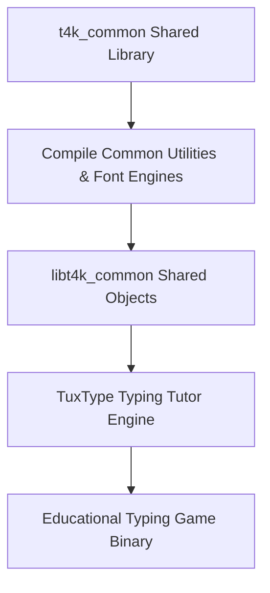

# TuxType Packaging and Compilation Suite

<div align="center">

[](https://isocpp.org)
[](https://github.com/tux4kids)
[](LICENSE)

</div>

Source code integration, packaging configuration, and compilation environment for TuxType (touch typing tutor) and the shared `t4k_common` library.

---

## Build Architecture



---

## Overview

TuxType is an open-source educational typing tutor designed for children and beginners to develop touch-typing agility through interactive arcade mini-games.

---

## Compilation

```bash
# Compile shared library
cd t4kcommon
./configure
make

# Compile TuxType binary
cd ../tuxtype
./configure
make
./src/tuxtype
```

---

## License

This compilation repository is licensed under the MIT License. See [LICENSE](LICENSE) for details. TuxType itself is licensed under GNU General Public License v2.0.
